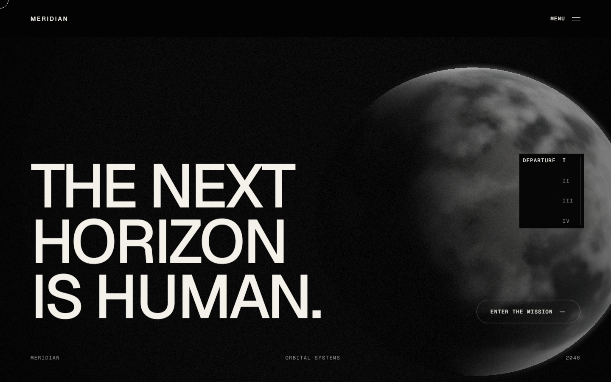
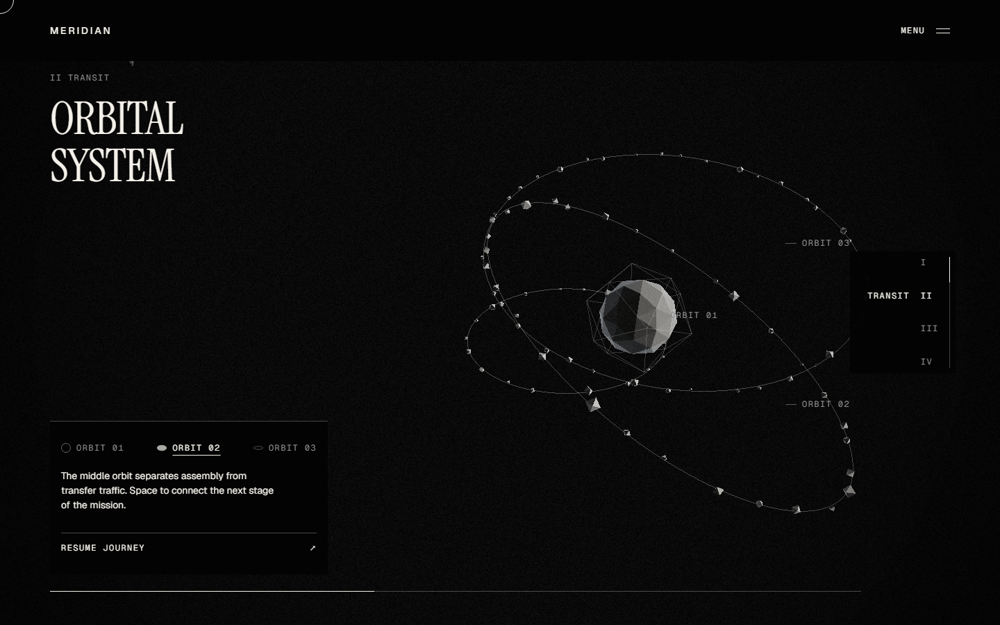
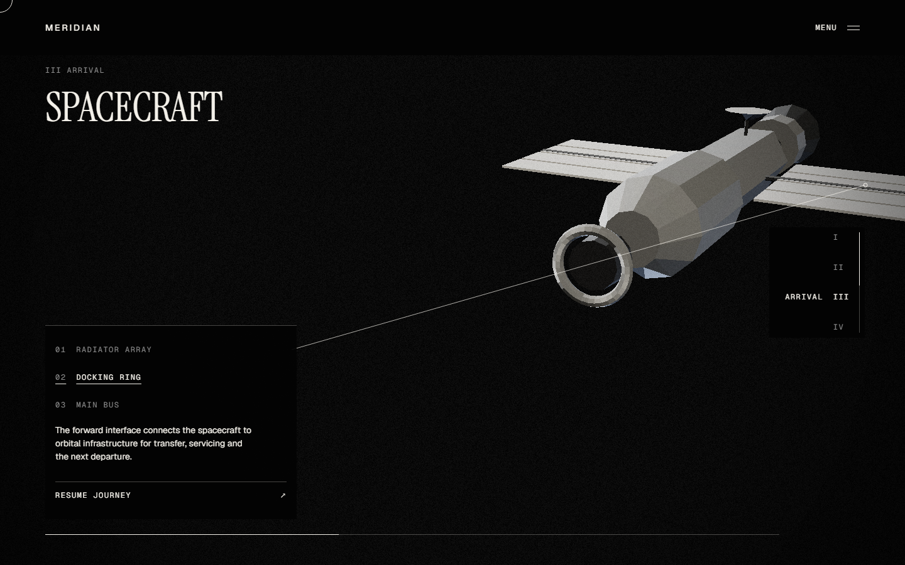
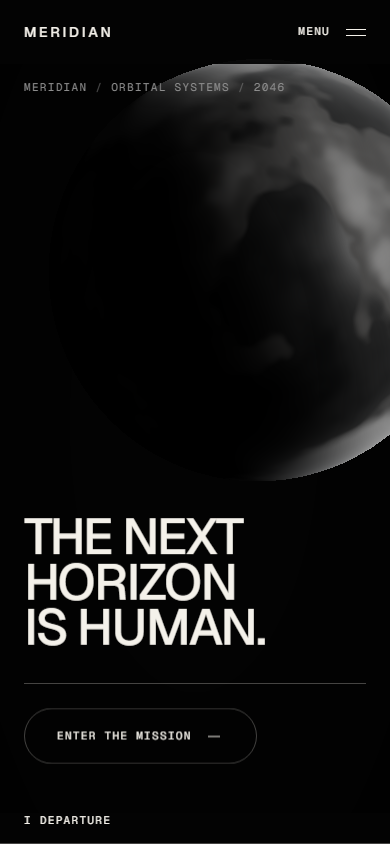
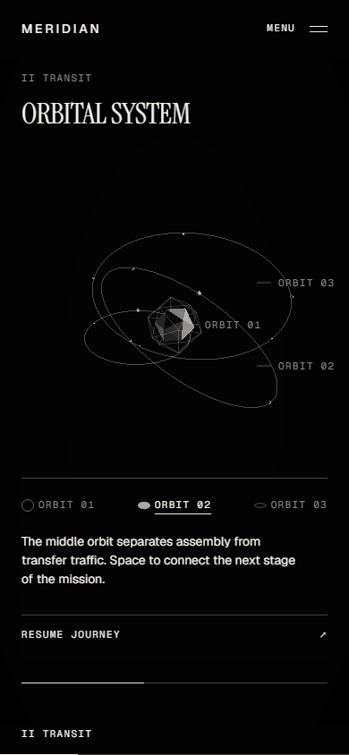
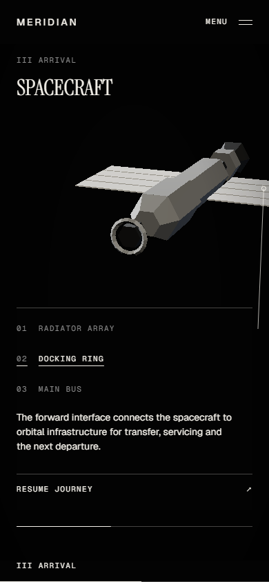

# MERIDIAN

An interactive aerospace concept website with a cinematic, scroll-driven 3D journey. Explore orbital formations and inspect a spacecraft through responsive, animated camera views.

[Türkçe README](README.tr.md)



## Experience

- Scroll through a continuous story: departure, manifesto, orbital systems, timeline, technology, spacecraft, statistics, stories, and return.
- Select **ORBIT 01–03** to isolate orbital formations and read their descriptions.
- Select **Radiator Array**, **Docking Ring**, or **Main Bus** to inspect the spacecraft. Camera transitions follow an external arc, and selected components separate slightly.
- Choose **Resume Journey** to return to the scroll-driven tour at your current position. Selecting the same item again also clears the selection.
- Use keyboard controls or touch. Reduced-motion preferences switch inspection views without spatial animation.

## Screenshots

Real browser captures at **1440 × 900** (desktop) and **390 × 844** (mobile). These are viewport captures; scroll and selection effects can be explored by running the app.

### Desktop





### Mobile

<p>
  
  
  
</p>

## Run locally

Use **Node.js 20.9 or later** and **pnpm 12.8.1** (the version pinned in `package.json`). No environment variables or external service credentials are required for the current frontend.

```bash
pnpm install
pnpm dev
```

Open [localhost:3000](http://localhost:3000).

To run the production build:

```bash
pnpm build
pnpm start
```

## Stack

| Area | Tools |
| --- | --- |
| Application | Next.js 16 App Router, React 19, TypeScript |
| 3D | Three.js, React Three Fiber, Drei, postprocessing |
| Motion | GSAP, Lenis, Framer Motion |
| State and styling | Zustand, CSS, Tailwind CSS 4 |
| Verification | Playwright, axe-core, ESLint, Lighthouse CI |

## Project structure

```text
app/                    App Router entry points and layout
components/canvas/      3D scene, camera, geometry and effects
components/sections/    Page sections and inspection controls
components/ui/          Shared interface elements
data/                   Copy, inspection descriptions and content
hooks/ lib/ store/      Shared behavior and application state
styles/ shaders/        Styles and shader sources
e2e/                    Browser tests and visual baselines
docs/screenshots/       Desktop and mobile README screenshots
```

## Checks

```bash
pnpm lint
pnpm typecheck
pnpm exec playwright install chromium
pnpm test:e2e
```

Playwright uses four configurations: desktop, mobile, and both with reduced motion. It starts a production server when needed, or reuses an existing server outside CI. Visual baselines cover ten sections per configuration; dynamic canvas content is hidden in those regression snapshots. The README screenshots include the actual 3D scene.

The latest interaction verification passed **44 checks** with **4 expected skips**, plus all **4 visual projects / 40 section baselines**. Production build, lint, and TypeScript checks passed. These results describe the verified revision; rerun the commands after changes.

## License

[MIT](LICENSE) © 2026 Ayberk Arda. Third-party dependencies retain their respective licenses.
